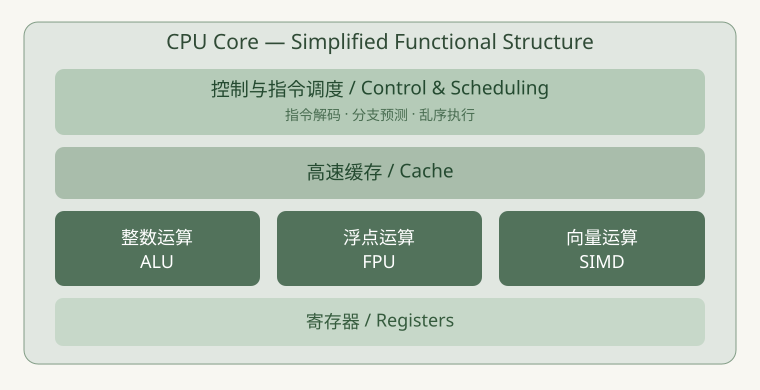
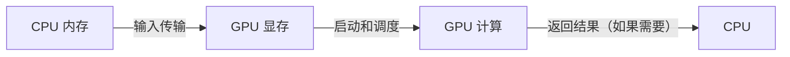

# CPU 与 GPU：计算架构、并行与加速原理

> 学习笔记 · 2026-11-16 · Hardware / 硬件 · **+5 XP**

> 核心结论：GPU 的优势通常不是每个计算单元更快，而是把更多硬件资源用于大量相似计算的并行吞吐。必须把数据传输、启动与调度开销计入总耗时。

## 1. CPU 和 GPU 的硬件设计

**一块芯片上有多少计算资源，以及这些资源如何组织**，决定了它更适合哪类任务。

芯片不是一个完整的计算器，而是由许多不同功能的电路构成。

| 硬件 | 英文 | 作用 |
|---|---|---|
| 运算单元 | ALU / FPU | 整数、浮点加减乘除 |
| 控制单元 | Control Unit | 指令解码、执行调度 |
| 寄存器 | Registers | 临时保存计算数据 |
| 高速缓存 | Cache | 保存常用数据，降低内存访问等待 |

### CPU 内部结构（简化）



CPU 投入更多资源解决：下一条指令是什么？遇到 `if` 如何预测分支？等待内存时能否先执行其他无依赖指令？能否把常用数据保存在缓存里？

### GPU 内部结构（简化）


GPU 包含多个 SM（Streaming Multiprocessor），每个 SM 具有 warp 调度、执行单元、寄存器等资源。GPU 倾向于投入更多资源进行大规模并行数值计算，而不是为每个线程提供完整 CPU 式控制能力。

## 2. 指令共享与线程

CPU、GPU **都有线程**，但组织方式不同：

- **CPU 多核**：多个独立 CPU 核心处理不同任务。
- **SMT / 超线程**：一个 CPU 核心维护多个硬件线程，共享部分执行资源。
- **CPU SIMD**：一条向量指令处理多个元素。
- **GPU SIMT**：NVIDIA 的 warp 通常包含 32 个线程，许多线程按照相似指令处理不同数据，共享部分指令调度资源。

```text
              Warp Scheduler
                 ADD 指令
       ┌──────────┼──────────┐
       ▼          ▼          ▼
    Thread 0   Thread 1   Thread 31
    a[0]+b[0]  a[1]+b[1]  a[31]+b[31]
```

共享指令控制资源，让芯片能把更多资源分配给实际运算。GPU 也能执行不同的分支，但同一 warp 内分支差异较大可能降低效率。

## 3. 延迟与吞吐量

- **延迟（Latency）**：一个任务开始到完成的时间。
- **吞吐量（Throughput）**：单位时间完成多少个任务。

| 设备（教学假设） | 单任务延迟 | 同时运行 | 理想吞吐量 |
|---|---:|---:|---:|
| A | 1 秒 | 1 个任务 | 1 个/秒 |
| B | 5 秒 | 100 个任务 | 20 个/秒 |

设备 B 单个任务花费更长时间，但一批任务完成得更快。CPU 通常更重视灵活性与低延迟；GPU 更重视高吞吐量。

## 4. Tensor 是什么？

Tensor 可以直观理解为**多维数组**：

```text
标量： 5                          shape: ()
向量：[1, 2, 3]                  shape: (3,)
矩阵：[[1,2], [3,4]]             shape: (2,2)
三维 Tensor：多个矩阵堆叠         shape: (N,2,2)
```

基础预测系统每个 instanceID 有 23×23 的精度矩阵；把 10,000 个矩阵堆叠得到 `(10000,23,23)` 的三维 Tensor。GPU 可以让大量线程分别处理不同的矩阵元素或实例，批量执行相似运算。

```python
import torch
psi = torch.zeros(10000, 23, 23, device="cuda")
F = torch.randn(10000, 23, device="cuda")
psi = psi + F.unsqueeze(2) * F.unsqueeze(1)
```

这是批量执行每个实例的秩一精度更新。Tensor 是数据组织方式，不是加速本身。

## 5. GPU 的时间成本



总耗时近似为：**输入传输 + GPU 启动 + 计算 + 输出传输 + 其他开销**。

| 环节（教学假设） | 时间 |
|---|---:|
| CPU → GPU | 1.5 ms |
| GPU 启动和计算 | 0.2 ms |
| GPU → CPU | 1.5 ms |
| **总计** | **3.2 ms** |

如果 CPU 完成同样任务只需要 2 ms，即使 GPU **纯计算**更快，整体仍然更慢。

## 6. 基础预测系统的并行结构

约 **10,000 个 instanceID × 390 个出发日期 = 390 万次更新**。每个实例每天只有一个 DCP 观测。

```text
                      出发日期 → 顺序更新
                   D1    D2    D3   …   D390
instanceID 1        ●  →  ●  →  ●   …    ●
instanceID 2        ●  →  ●  →  ●   …    ●
instanceID 3        ●  →  ●  →  ●   …    ●
...
instanceID 10000    ●  →  ●  →  ●   …    ●

不同 instanceID：可以并行
同一 instanceID 的不同日期：存在状态依赖，需按顺序
```

- **CPU 方案**：将实例分给不同 CPU 核心，每个实例按日期推进。
- **GPU 方案**：把大量实例状态保存在显存中，逐日期批量并行计算。
- **数值算法优化**：对于均值更新中的 `A^{-1}b`，通常先考虑直接求解 `Ax=b`（如 Cholesky 求解），而不是显式求逆。
- **工程验证**：分离数据库 I/O 和纯计算的耗时，比较 CPU 单线程、CPU 多核、GPU 批量实现的整体耗时与数值一致性。

**一句话复习：CPU 侧重少量强大核心与复杂控制；GPU 侧重大量并行执行资源、高吞吐量的指令组织和内存系统。**
